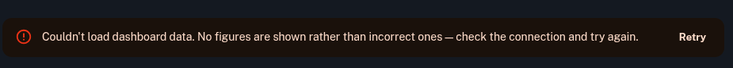

_all page_

1.  ami jei image disi oi doroner jei koyta alart ache sob remove kore toast dite hobe like notifaction asle jmn akti toast ache oirokom dite hobe

## user page

<!-- 1 user delete korle delete hoy nah. active r inactive ta thik korte hobe. suspend thakle je unsuspend kora jay amon kichu kora lagbe  -->

<!-- 1. user update korle update hoy kintu role ta change kore update korle hoy nh.
   1.1 suspend user login korte parbe nh. r jodi login thake tahole logout hoye jabe.
   1.2 -->

## order page

create page
new customer er button ta thakbe na jodi notun customer hoy tahole jokhon submit korbe tokhon new customer add hoye jabe auto.
product select korte gele stock thaka product gulio dekhay je undefind out of stock aita fix korte hobe.

<!--
0.0 \*\*all page a alart deoya ache kichu action korle alart ache aita toast hobbe.

1. main order page
   1.0 date column a year ta thakbe nh sudu month r date r time thakbe.
   1.1 quick edit ta action menu er vitore dite hobe.
2. order create
   2.0 create page a jei koya ta autocomplete ache oiguli change kore amar componets er autocomplete ta use korte hobe.
   2.1 create page a product select korar por barcode r barcode number ashe aita remove korte hobe.
   2.2 create page er joto content ache aiguli premium korte hobe r short korte hobe -->

## Settigs

1 product settings
1.1 default Warehouse
1.2 Stock Out Product can Order <!--product stock thakle ki order korte parbe kina-->
1.3 Out Of Stock can Submit Courier <!--stock na thaklo ki courier a submit korte parbe kina-->
1.4 Variation Select on Order
1.5 Decrease Stock On <!--kon status a order gele stock kombe>

2 order settings
2.0 order list default status show <!-- aita order page a jei order list ache oikhane default all thakbe aitar akti setting hobe jekhan theke choose korte parbe je konta select thakbe -->
2.0.1 order table header status sorting <!-- aita hobe order table er top jei order status ta ache oita sorting kora jabe jmn kontar por konta hobe -->

2.1 order table column sorting <!-- aita diye table er column guli sajate parbe je kon ta kon jaygay bosbe -->

2.2 order status sorting <!-- kon status kon jaygay bosbe r kontar por konta hobe r konta thakbe r konta thakbe na. ai order status sorting ta sob jaygay kaj korbe aita setting theke korle jmn korse sob jaygay temoni thakbe. proti order status er jonno alada alada kore set korte parbe.

2.3 default product <!-- aita order create page er jonno aita jodi set kora thake tahole oi product ti create page a select hoye thakbe.

2.4 defaul Source <!-- aita order create page er jonno aita jodi select kora thake tahole oi source ti create page a set hoye thakbe.

2.5 defautl status <!--aita order create page er jonno aita jodi select kora thake tahole oi status ti create page a set hoye thakbe. -->

2.6 Order ID prefix
2.7 Invoice No prefix.
2.8 default Payment Method
2.9 Payment Method <!-- Payment Method add korte parbe remove korte parbe.
